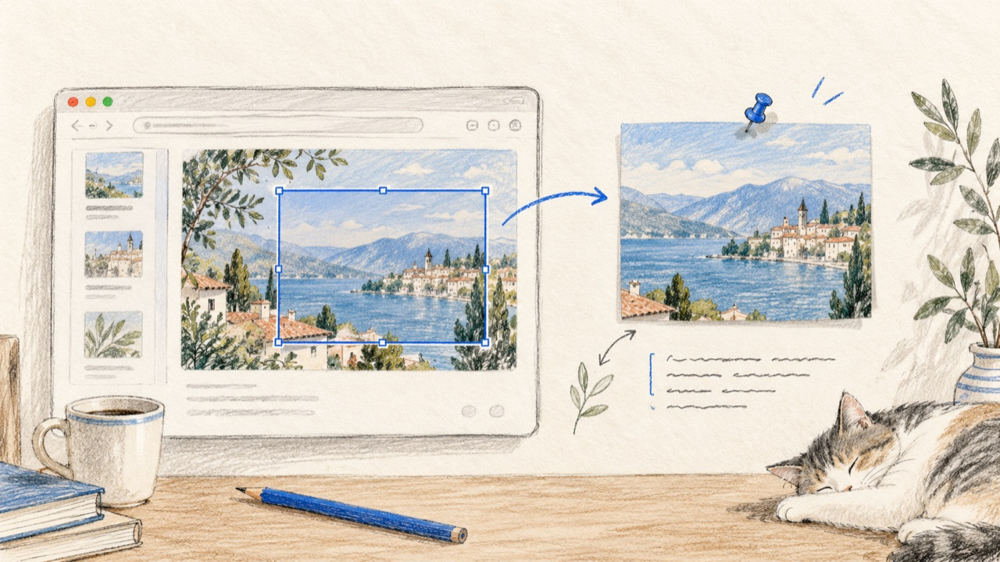

<div align="center">



# 贴刻 TieKe

**macOS 截图贴图工具 —— 截图、标注、贴图、本机识字，一气呵成，数据全部留在本机。**

[](https://github.com/liangjfblue/TieKe/releases)
[](https://tiek.liangjf.com)
[](https://github.com/liangjfblue/TieKe#构建要求)
[](https://github.com/liangjfblue/TieKe/releases)
[](LICENSE)
[](https://github.com/liangjfblue/TieKe/actions/workflows/deploy-website.yml)

**[下载最新版](https://github.com/liangjfblue/TieKe/releases) · [官网](https://tiek.liangjf.com) · [问题反馈](https://github.com/liangjfblue/TieKe/issues)**

</div>

---


## 功能

- **截图即贴图**：全局快捷键截图，选区立即变成置顶贴图
- **六种标注工具**：箭头、文字、马赛克、聚光灯、放大镜、方框，标注直接画在截图上
- **样式实时可调**：文字字号 / 颜色 / 加粗 / 底色，聚光灯暗度 / 形状，放大镜倍数，改一处全部即时生效
- **本机识字**：系统 Vision 引擎离线识别，一键复制文字结果
- **重启恢复**：贴图位置、大小、标注、识字结果全部落盘，重开应用原样恢复
- **多来源贴图**：从剪贴板或图片文件创建贴图；截图可复制或导出 PNG
- **本地优先**：无账号、无网络请求，数据存放于本机目录

## 快捷键

⌘ Command · ⌃ Control · ⌥ Option · ⇧ Shift

| 场景 | 操作 | 快捷键 |
|---|---|---|
| 全局 | 截图并贴图 | ⌘⇧2 |
| 全局 | 从剪贴板贴图 | ⌃⌥2 |
| 全局 | 截图并复制 | ⌃⌥3 |
| 全局 | 截图并保存 | ⌃⌥4 |
| 全局 | 从文件贴图 | ⌃⌥O |
| 框选中 | 切换标注工具 | A、T、M、S、Z、G |
| 框选中 | 撤销 / 重做标注 | ⌘Z / ⌘⇧Z |
| 框选中 | 贴图 · 复制 · 保存 | 回车 · ⌘C · ⌘S |
| 框选中 | 取消 | Esc |
| 贴图 | 打开标注 | 双击 / 空格 / 右键菜单 |
| 贴图 | 复制图片 · 复制文字 | ⌘C · ⇧C |
| 贴图 | 关闭 | Esc |

若全局组合键已被其他应用占用，菜单栏图标提示会列出失败的组合。

## 构建要求

- macOS 15 或更高版本
- Xcode 与 [XcodeGen](https://github.com/yonaskolb/XcodeGen)

## 构建与运行

```sh
xcodegen generate
xcodebuild -project TieKe.xcodeproj -scheme TieKe -configuration Debug \
  -derivedDataPath DerivedData test CODE_SIGNING_ALLOWED=NO
open DerivedData/Build/Products/Debug/TieKe.app
```

首次截图需要授予系统「屏幕录制」权限：系统设置 → 隐私与安全性 → 屏幕录制。
未签名的调试构建在每次重建后可能需要重新授权；用 Apple Development 证书签名可保留授权。

## 数据存储

数据目录为 `~/Library/Application Support/TieKe/`：

- `pins.sqlite` — 贴图索引（位置、尺寸、开启状态、识字结果、来源信息）
- `Data/<UUID>.png` — 贴图像素

写入顺序：先原子保存 PNG，再写数据库；数据库写入失败会回滚删除 PNG。

## 技术栈

Swift + AppKit。截屏用 ScreenCaptureKit，文字识别用 Vision，全局快捷键用 Carbon Event Manager，存储用 SQLite（WAL）。无第三方依赖。

## 许可

MIT
